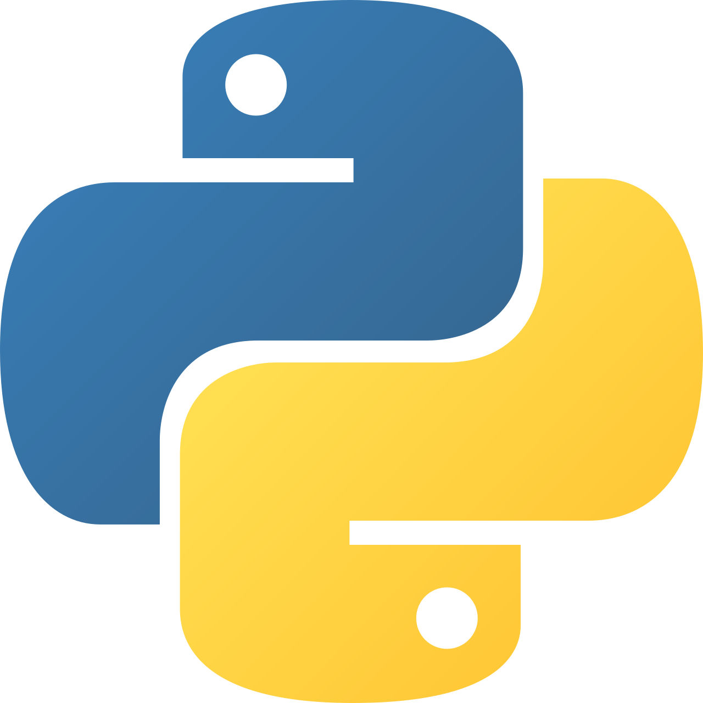
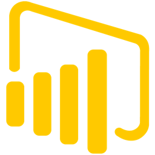
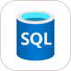
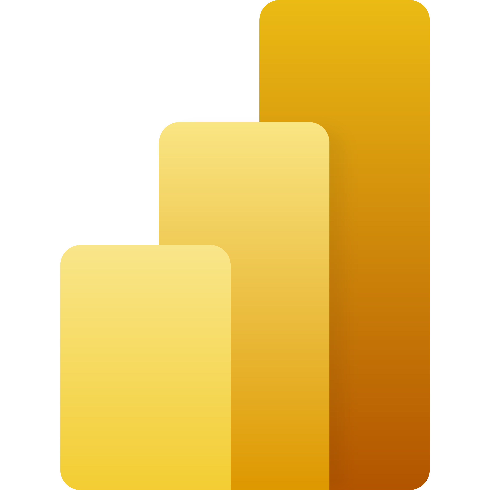
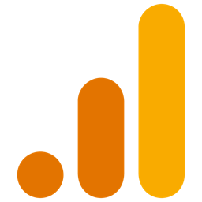
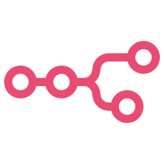
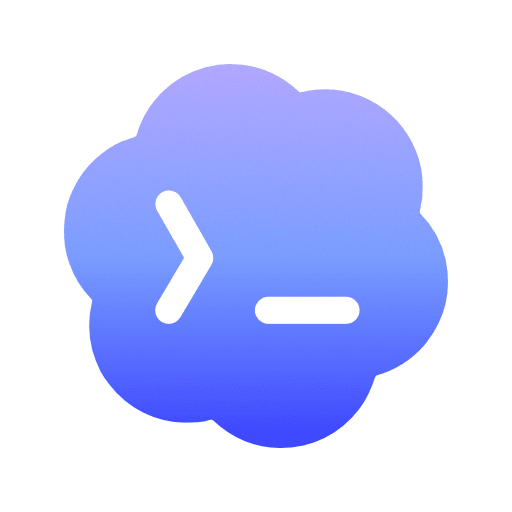
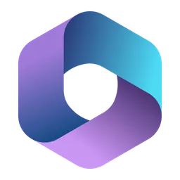

<picture>
  <source media="(prefers-color-scheme: dark)" srcset="assets/banner-dark.svg">
  
</picture>

I help companies understand their processes, organize their data and turn scattered information into decisions, dashboards and solutions they can act on.

- **Currently:** working independently on data, BI and automation projects, remotely from Paraguay
- **Building:** Power BI models versioned as code, internal web apps and AI automations
- **Ask me about:** Power BI, DAX, Power Query, Python, n8n and process mapping
- **Education:** BSc in Business Informatics
- **Languages I speak:** Spanish (native), English (fluent), German (B2)
- **Reach me:** [LinkedIn](https://www.linkedin.com/in/chiara-mireya-barua-espinola/)

## Languages I code in

<table>
  <tr>
    <td align="center" width="96"> Python</td>
    <td align="center" width="96"> DAX</td>
    <td align="center" width="96"> TypeScript</td>
    <td align="center" width="96"> JavaScript</td>
    <td align="center" width="96"> SQL</td>
    <td align="center" width="96"> VBA</td>
  </tr>
  <tr>
    <td align="center"> HTML</td>
    <td align="center"> CSS</td>
  </tr>
</table>

## Tools

#### Data & BI

<table>
  <tr>
    <td align="center" width="96"> Power BI</td>
    <td align="center" width="96"> Excel</td>
    <td align="center" width="96"> PostgreSQL</td>
    <td align="center" width="96"> Looker Studio</td>
    <td align="center" width="96"> Google Analytics</td>
    <td align="center" width="96"> pandas</td>
  </tr>
  <tr>
    <td align="center"> NumPy</td>
    <td align="center"> Matplotlib</td>
    <td align="center"> Jupyter</td>
  </tr>
</table>

#### Automation & AI

<table>
  <tr>
    <td align="center" width="96"> n8n</td>
    <td align="center" width="96"> Claude Code</td>
    <td align="center" width="96"> Codex</td>
  </tr>
</table>

#### Web apps

<table>
  <tr>
    <td align="center" width="96"> React</td>
    <td align="center" width="96"> Astro</td>
    <td align="center" width="96"> Vite</td>
    <td align="center" width="96"> Tailwind CSS</td>
    <td align="center" width="96"> Node.js</td>
    <td align="center" width="96"> Docker</td>
  </tr>
</table>

#### Process & systems

<table>
  <tr>
    <td align="center" width="96"> draw.io</td>
    <td align="center" width="96"> SAP</td>
    <td align="center" width="96"> Microsoft 365</td>
    <td align="center" width="96"> Google Workspace</td>
  </tr>
</table>

#### Engineering practice

<table>
  <tr>
    <td align="center" width="96"> Git</td>
    <td align="center" width="96"> GitHub Actions</td>
    <td align="center" width="96"> Vitest</td>
  </tr>
</table>

## What I build

Most of this work lives in private repositories, and client names are left out on purpose.

| Project | What it does | Built with |
|---|---|---|
| **Power BI models as code** | Fleet and workshop control, commercial profitability | Power BI (PBIP, TMDL), DAX, Power Query M, Python |
| **Project management web app** | Clients, budgets, stages, tasks and documents for construction projects | React, TypeScript, Express, PostgreSQL, Docker, OpenAI API |
| **Commercial profitability prototype** | Role-based view of commercial contribution with recommended actions | HTML, JavaScript, Python |
| **Activity and hours tracker** | Personal work-hours tracking on top of ActivityWatch | TypeScript, Vite, Vitest, PowerShell |
| **Audio transcriber** | Local web app that transcribes audio | Python, Whisper |
| **Sentiment analysis** | Sentiment analysis of tweets on a chosen topic | Python, Jupyter, pandas, NLTK |
| **Professional portfolio** | Trilingual site in Spanish, English and German | Astro, TypeScript, CSS |

## Activity

<picture>
  <source media="(prefers-color-scheme: dark)" srcset="assets/calendar-dark.svg">
  
</picture>
